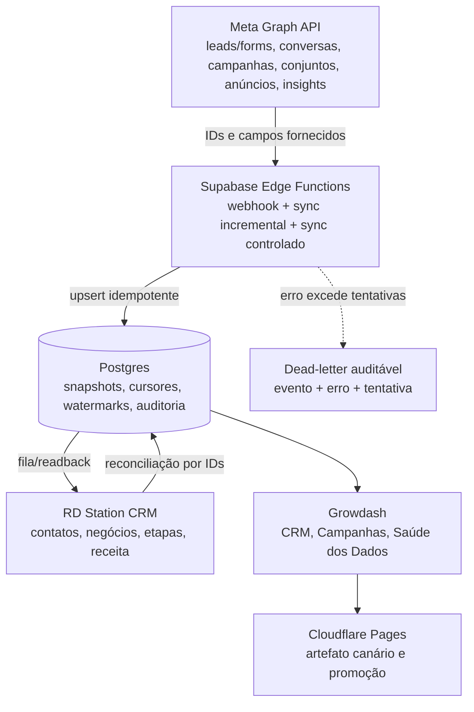

# Grafo de dependências Meta ↔ RD

Versão: `sync-graph-v1`
Contrato: `sync-v1`
SLO: no máximo 1% de execuções iniciadas em `failed` ou `blocked` na janela móvel de 30 dias.

| Nó | Contrato de entrada | Contrato de saída | Saúde e bloqueio |
|---|---|---|---|
| Meta Graph | token, conta, versão Graph, escopo e cursor | IDs, nomes, origem e delivery quando fornecidos | `401/403` bloqueiam; `429/5xx/timeout` retomam |
| Edge Functions | payload validado sem macros não resolvidas | `sync_run_id`, status e contagens | contrato inválido bloqueia promoção |
| Postgres | chave idempotente por provedor/conta/objeto/evento/escopo | snapshot + cursor + auditoria | RLS/advisors/migration são gates |
| RD Station | contato/deal e identificadores estáveis | confirmação/readback ou outbox | indisponibilidade não apaga Meta |
| Growdash | somente snapshot confirmado e estado explícito | UI com `success/partial/stale/failed/blocked` | estado não pode esconder falha |
| Cloudflare | build, SHA, source maps privados e smoke | deployment promovido ou rollback | falha fechada mantém versão anterior |

O posicionamento só é preenchido quando a Meta o devolve. `feed`, `story` e `reels`
não são inferidos a partir de plataforma, objetivo, nome da campanha ou criativo.
